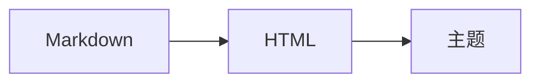

<div align="center">

# ClassIsBand！Blog！

一个以 Cosmos 深度定制的博客，用 Material 3 Expressive 深度定制

[](https://hexo.io/)

[](https://matraic.github.io/m3e/)
[](https://katex.org/)
[](https://mermaid.js.org/)

</div>

## 特性

### 动态配色

- [x] 全站配色由 [M3E](https://matraic.github.io/m3e/) 的 `m3e-theme` 从一枚源色生成，支持浅色 / 深色自动切换
- [x] 顶栏「配色」对话框可选 8 个预设源色，或用原生取色器自定义，切换时整页 700ms 平滑过渡
- [x] 九种 Material 3 配色方案（Vibrant / Expressive / Fidelity / Tonal Spot / Content / Neutral / Monochrome / Rainbow / Fruit Salad）即时切换
- [x] 选择结果写入 `localStorage`，按「源色 + 方案 + 明暗」分键缓存生成的令牌，回访时不再加载运行时
- [x] 页眉、正文、代码块、分割线、高亮、提示框全部跟随同一套语义色

### 内容渲染

- [x] 五种 GitHub 风格提示框（`> [!NOTE]` …），交给 M3E 的 `m3e-callout` 渲染，并只在含提示框的页面按需加载
- [x] KaTeX 数学公式：`$行内$` 与 `$$块级$$` 在构建期渲染成静态 HTML，零运行时
- [x] Mermaid 图表：```` ```mermaid ```` 围栏在浏览器端渲染，配色从 CSS 令牌读取，跟随当前主题
- [x] `==高亮==` 语法（Obsidian 风格），滚动进入视口时从左往右扫过
- [x] 代码块行标记、复制按钮、表格对齐、任务清单、`figure` 图注、`details` 折叠块
- [x] 归档页按年份分组，支持标签筛选与关键词搜索，切换标签使用站点的 View Transition

### 阅读体验

- [x] 响应式排版，桌面双栏（目录 + 正文）、移动单栏
- [x] 文章目录跟随滚动高亮，阅读进度条，上一篇 / 下一篇
- [x] 深色 / 浅色跟随系统偏好，`prefers-reduced-motion` 下自动关闭动效
- [x] 文章头部显示分类、标签、日期与阅读时长，标签可直达归档筛选

## 技术栈

| 层 | 方案 |
| --- | --- |
| 静态生成 | [Hexo](https://hexo.io/) 8 + EJS 模板 |
| 主题 | [Cosmos](themes/cosmos) 1.0.5（MIT，随仓库附源码） |
| 设计系统 | [M3E](https://matraic.github.io/m3e/) 2.10.1（Material 3 Expressive Web Components） |
| 数学公式 | [KaTeX](https://katex.org/) 0.19（构建期渲染） |
| 图表 | [Mermaid](https://mermaid.js.org/) 12.2（按需加载） |
| 包管理 | pnpm |


## 本地开发

```sh
pnpm install
pnpm server    # 本地预览，默认 http://localhost:4000
pnpm build     # 生成静态站点到 public/
```

需要注意的几点：

- 修改 `scripts/` 下的插件后要**重启** `hexo server`，插件只在启动时加载
- 修改 `scripts/markdown-extras.js` 这类渲染过滤器后要 `hexo clean`，否则 `db.json` 里的旧渲染结果会跳过新逻辑
- 修改 `_config.cosmos.yml` 同样需要重启服务

## 写作

文章就是普通 Markdown，额外支持：

````markdown
> [!NOTE]
> 五种提示框：NOTE / TIP / IMPORTANT / WARNING / CAUTION

行内公式 $E = mc^2$，块级公式：

$$
\int_0^1 x^2 \, dx = \frac{1}{3}
$$



==等号高亮==
````

## 致谢

- [Cosmos](https://github.com/cweiai/hexo-theme-cosmos) —— 主题底座，MIT
- [M3E](https://github.com/matraic/m3e) —— Material 3 Expressive 组件与动态取色，MIT
- [KaTeX](https://katex.org/)、[Mermaid](https://mermaid.js.org/) —— 公式与图表，MIT
