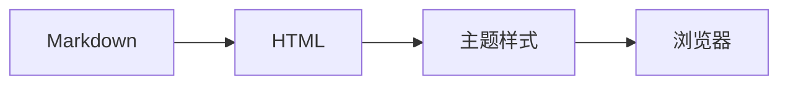
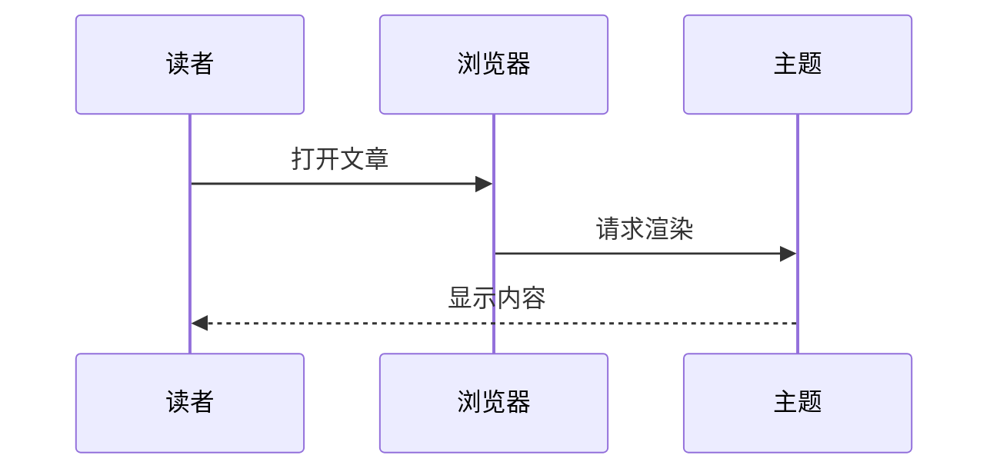

这一页把主题支持的渲染效果集中放一遍：标题、文本、列表、引用、代码、表格、图片，以及原始 HTML。左侧目录会按这里的二级标题生成。

## 标题层级

正文里的 `##` 到 `####` 都有独立字号，`##` 会进入侧边目录。

### 三级标题

这里是一段普通正文。段落间距和内边距都由主题统一控制，长段落会自动按阅读栏宽度换行，不需要手动插换行。

#### 四级标题

四级标题更接近正文的字号，适合在小节内部再分一层。

## 文本样式

**加粗**、*斜体*、***粗斜体***、~~删除线~~、`行内代码`、==等号高亮==，以及用 HTML 写的 <mark>高亮</mark> 和 <kbd>Ctrl</kbd> + <kbd>C</kbd>。

高亮也可以写在句子中间，比如这句话里的 ==关键结论== 会被标出来，而 `a == b` 这种代码里的等号不受影响。

链接分两种：站外的 [Hexo 文档](https://hexo.io/docs/) 会带下划线，站内的可以指向 [另一篇文章](/10/23/callout-test/)。裸链接也会自动识别：https://hexo.io/

缩写用 HTML：<abbr title="Material Design 3">MD3</abbr> 悬停可以看到说明。

## 列表

无序列表：

- 第一项
- 第二项
  - 嵌套项
  - 另一个嵌套项
- 第三项

有序列表：

1. 准备材料
2. 按顺序执行
3. 检查结果

任务清单：

- [x] 已经完成的事
- [x] 另一件完成的事
- [ ] 还没做的事

## 引用与提示框

普通引用会使用衬线斜体：

> 引用里的文字会更窄一些，字号略大，主要用来放他人的话。

> 多段引用也支持。
>
> 第二段会与第一段保持同样的缩进和边距。

提示框用 GitHub 语法写，五种类型都能识别：

> [!NOTE]
> 一般性说明，适合补充上下文。

> [!TIP]
> 小技巧或推荐做法。

> [!IMPORTANT]
> 需要特别注意的关键信息。

> [!WARNING]
> 可能造成问题的风险提示。

> [!CAUTION]
> 危险操作，后果较严重。

## 代码块

带语言标记的代码块会自动高亮，并在右上角出现复制按钮：

```js
const palette = ['#6750A4', '#0061A4', '#006A6A'];
const scheme = palette.map(color => color.toLowerCase());
console.log(scheme.join(', '));
```

需要标出重点行时用 Hexo 的 `codeblock` 标签，`mark` 里的行号会加底色和左侧强调线：


const first = 1;
const second = 2;
const total = first + second;


也可以给代码块加标题：


type Variant = 'vibrant' | 'expressive' | 'monochrome';
const current: Variant = 'vibrant';


行内代码适合提函数名：`getComputedStyle()`、`m3e-theme`。

## 表格

| 配置项 | 类型 | 默认值 |
| :--- | :---: | ---: |
| `home.mode` | 字符串 | `cover` |
| `post.toc` | 布尔值 | `true` |
| `style.layout.max_width` | 尺寸 | `1280px` |

列对齐用冒号控制：`:---` 左对齐、`:---:` 居中、`---:` 右对齐。

## 图片

正文里的图片会限制在阅读栏内，按原始比例缩放：


需要图注时用 HTML 的 `figure`：

<figure>
  
  <figcaption>用 figure 与 figcaption 可以给图片加说明文字。</figcaption>
</figure>

## 原始 HTML

`details` 折叠块适合放补充材料：

<details>
  <summary>点开看一段说明</summary>
  <p>折叠区域里的内容同样是普通正文样式，可以包含 <strong>加粗</strong>、链接和列表。</p>
  <ul>
    <li>列表项一</li>
    <li>列表项二</li>
  </ul>
</details>

## 长内容与换行

超长单词或链接会强制换行，不会把布局撑破：

https://example.com/a-very-long-path/that/keeps/going/and/going/with-many-segments/components/index.html

手动换行用行尾两个空格，或者直接分段；这一行之后有强制换行  
所以这里另起了一行。

---

最后是一条分隔线。

---

## 数学公式

行内公式用单个美元符号：$E = mc^2$，显示公式用两个：

$$
\int_0^1 x^2 \, dx = \frac{1}{3}
$$

矩阵和希腊字母也没问题：

$$
A = \begin{pmatrix} a & b \\ c & d \end{pmatrix}, \quad \alpha + \beta = \gamma
$$

## 图表

用 Mermaid 代码围栏写流程图：



时序图同样支持：


